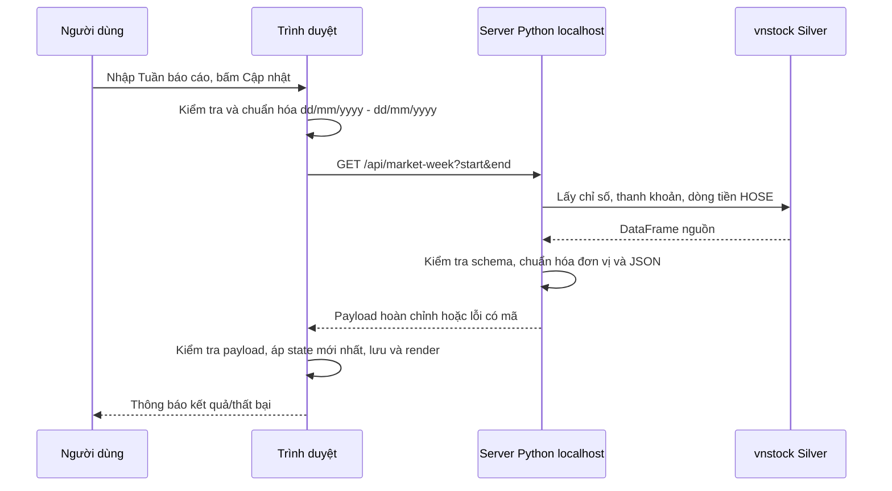

# Cập nhật dữ liệu tuần bằng vnstock - Kế hoạch triển khai

## Giai đoạn 0: Làm rõ đầu vào

### Phân loại

Đây là hạng mục **bổ sung tính năng** cho ứng dụng báo cáo CNF hiện có. Tính năng trải trên giao diện JavaScript, HTTP server Python cục bộ và adapter cho `vnstock`, nên dùng quy trình Add Feature gồm 6 giai đoạn.

### Bối cảnh đã xác nhận

- Ứng dụng là static web, script toàn cục theo thứ tự `js/config.js` → `js/core.js` → `js/renderer.js` → `js/logo-data.js` → `js/app.js`.
- State hiện có đã có các trường đích: `indices`, `trading_value`, `foreign_flow`; Canvas chỉ đọc các trường này nên không cần đổi layout.
- Người dùng chọn dịch vụ Python cục bộ, lấy dữ liệu theo khoảng trong trường “Tuần báo cáo”, phạm vi khối ngoại là HOSE.
- Phạm vi tự động: 4 chỉ số, biến động tuần, GTGD bình quân/ngày và tối đa 5 phiên mua/bán ròng HOSE. Nội dung nhận định, chiến lược, MA, top mua/bán và ảnh vẫn nhập thủ công.
- Môi trường hiện tại không có interpreter Python khả dụng qua `py`; việc chạy và kiểm thử tích hợp sẽ dùng môi trường Python mà người dùng đã cài `vnstock` Silver.

### Kết quả khảo sát

- Ba test Node hiện có là các assertion đọc chuỗi file; chưa có test luồng cập nhật thị trường hay test Python.
- Workspace không phải Git repository nên không có lịch sử/diff để dùng làm tham chiếu.
- Vnstock Data có `Market().index(...).ohlcv()` và `trade_history()` cho chỉ số, cùng dữ liệu `foreign_flow()`; tài liệu yêu cầu không đoán tên cột mà phải kiểm tra schema thực tế. [Tài liệu Market Layer](https://www.vnstocks.com/docs/vnstock-data/market-layer-v3)
- Python `http.server` phù hợp cho công cụ cục bộ nhưng không phù hợp production và mặc định có thể bind mọi interface; server phải bind cố định `127.0.0.1`, chỉ phục vụ app/API tối thiểu. [Tài liệu Python](https://docs.python.org/3/library/http.server.html)

## Giai đoạn 1: Phân tích yêu cầu

### Yêu cầu theo EARS

| ID | Yêu cầu |
| --- | --- |
| R1 | KHI người dùng bấm “Cập nhật dữ liệu”, HỆ THỐNG PHẢI phân tích trường “Tuần báo cáo” thành ngày bắt đầu/kết thúc hợp lệ trước khi gọi API. |
| R2 | KHI khoảng ngày hợp lệ, HỆ THỐNG PHẢI yêu cầu API cục bộ lấy dữ liệu VNINDEX, VN30, HNXINDEX và UPCOMINDEX trong cùng khoảng. |
| R3 | KHI API nhận được dữ liệu hợp lệ, HỆ THỐNG PHẢI trả đúng bốn chỉ số với điểm đóng cửa phiên cuối, chênh lệch và phần trăm so với phiên đầu. |
| R4 | KHI API nhận được thống kê thanh khoản VNINDEX hợp lệ, HỆ THỐNG PHẢI trả GTGD bình quân trên các phiên thực có trong khoảng, theo tỷ đồng. |
| R5 | KHI API nhận được dữ liệu khối ngoại HOSE hợp lệ, HỆ THỐNG PHẢI trả tối đa năm phiên theo thứ tự thời gian với giá trị ròng đơn vị tỷ đồng. |
| R6 | KHI API trả payload hoàn chỉnh và đúng schema, HỆ THỐNG PHẢI chỉ ghi đè `indices`, `trading_value`, `foreign_flow`, thời điểm cập nhật và nguồn; sau đó lưu localStorage và render lại Canvas. |
| R7 | KHI tuần báo cáo sai định dạng, API lỗi, hết thời gian chờ, thiếu dữ liệu hoặc schema đổi, HỆ THỐNG PHẢI giữ nguyên state hiện tại và báo lỗi có thể hành động. |
| R8 | KHI người dùng bấm cập nhật nhiều lần, HỆ THỐNG PHẢI chỉ áp dụng phản hồi của yêu cầu mới nhất và vô hiệu hóa nút trong thời gian yêu cầu đang chạy. |
| R9 | KHI server khởi động, HỆ THỐNG PHẢI chỉ bind `127.0.0.1`, không mở API ra mạng LAN/WAN và không nhận URL nguồn dữ liệu từ trình duyệt. |

### Ràng buộc đơn giản

- Dùng standard library Python (`http.server`, `json`, `datetime`) và `vnstock` đã cài; không thêm framework web/dependency.
- Một endpoint đọc duy nhất: `GET /api/market-week?start=YYYY-MM-DD&end=YYYY-MM-DD`.
- Không cache, không scheduler, không database, không CORS mở rộng và không thêm tầng xác thực vì server chỉ bind loopback.
- Adapter cô lập schema `vnstock` là cần thiết vì phiên bản Silver/nguồn dữ liệu có thể thay đổi; không tạo abstraction tổng quát cho các nguồn khác.

### Tiêu chí chấp nhận

1. Người dùng chạy server bằng interpreter có `vnstock`, mở URL localhost và bấm cập nhật với tuần hợp lệ.
2. Canvas hiển thị đủ bốn chỉ số, GTGD TB/ngày và tối đa năm cột khối ngoại HOSE từ payload mới.
3. Các vùng nằm ngoài phạm vi không thay đổi sau cập nhật.
4. Lỗi HTTP/schema/tuần sai không làm mất dữ liệu đang nhập.
5. API không lắng nghe ngoài `127.0.0.1` và không làm lộ stack trace trên giao diện.

## Giai đoạn 2: Đặc tả giải pháp

### Kiến trúc tối thiểu



### Hợp đồng API

```text
GET /api/market-week?start=YYYY-MM-DD&end=YYYY-MM-DD

200 {
  "indices": [{"name":"VNINDEX","close":"...","change":"...","percent":"..."}],
  "trading_value": "...",
  "foreign_flow": [{"date":"dd/mm","value": 0}],
  "meta": {"updated_at":"ISO-8601", "source":"vnstock ...", "start":"...", "end":"..."}
}

400 {"error":{"code":"INVALID_DATE_RANGE","message":"..."}}
502 {"error":{"code":"UPSTREAM_DATA_ERROR|SCHEMA_ERROR","message":"..."}}
```

Server trả 200 chỉ khi mọi trường bắt buộc có thể chuẩn hóa. Browser kiểm tra lần nữa trước khi ghi state. `foreign_flow` phải được sắp xếp tăng dần, tối đa 5 phần tử; giá trị ròng phải đổi sang tỷ đồng tại server bằng một quy ước cột/xác minh đơn vị cụ thể của bản `vnstock` đã cài.

### Đánh đổi

| Phương án | Ưu điểm | Nhược điểm | Độ phức tạp | An toàn | Khuyến nghị |
| --- | --- | --- | --- | --- | --- |
| HTTP server standard library bind localhost + adapter | Không dependency mới, trải nghiệm một nút bấm, tách Python/JS rõ ràng | Cần chạy một lệnh Python | Thấp | Cao trong phạm vi cục bộ | Chọn |
| Script xuất JSON rồi nhập tay | Rất ít mã server | Nhiều thao tác, không cập nhật trực tiếp | Thấp | Cao | Không chọn |
| Server framework/caching/scheduler | Mở rộng tốt | Vượt phạm vi, thêm dependency/vận hành | Cao | Trung bình | Không chọn |

### Các trường hợp biên

| Tình huống | Điều kiện kích hoạt | Hành vi mong đợi | Yêu cầu |
| --- | --- | --- | --- |
| Chuỗi tuần sai | Không khớp hai ngày `dd/mm/yyyy` hoặc đầu > cuối | Không gọi API, báo định dạng hợp lệ | R1, R7 |
| Tuần có lễ/ít hơn 5 phiên | Nguồn chỉ trả 1–4 phiên | Dùng các phiên thực có, giữ thứ tự tăng dần | R4, R5 |
| Không có phiên | Cả bốn chỉ số hoặc dòng tiền rỗng | Trả lỗi, không thay state | R3, R5, R7 |
| Schema thay đổi | Thiếu cột ngày/đóng cửa/giá trị | Adapter nêu mã `SCHEMA_ERROR`, không đoán giá trị | R3–R5, R7 |
| Giá trị nguồn là VND hoặc triệu đồng | Metadata/schema khác dự kiến | Xác minh và quy đổi duy nhất về tỷ đồng trước response | R5 |
| Bấm liên tiếp | Response cũ về sau response mới | Bỏ qua response không còn request id mới nhất | R8 |
| Server không chạy | `fetch` bị từ chối | Hiển thị hướng dẫn khởi động, giữ state | R7 |

### Xử lý ngoại lệ

| Ngoại lệ | Nguồn | Chiến lược | Tác động người dùng | Phục hồi |
| --- | --- | --- | --- | --- |
| `vnstock` chưa import được | Môi trường Python | 502 `VNSTOCK_UNAVAILABLE`, không phục vụ dữ liệu giả | Thông báo chạy đúng môi trường | Khởi động bằng interpreter đã cài thư viện |
| Lỗi mạng/nguồn dữ liệu | `vnstock`/upstream | Bắt lỗi, 502 mã tổng quát, không trả stack trace | Giữ số liệu cũ | Người dùng thử lại sau |
| Thiếu/sai schema | DataFrame upstream | Adapter từ chối payload | Giữ số liệu cũ | Cập nhật mapping sau khi kiểm tra `df.columns` |
| Payload không hợp lệ | Browser/API | Không mutate `data` | Báo lỗi dữ liệu | Người dùng thử lại |
| Cổng đã dùng | HTTP server | Báo cổng và thoát rõ ràng | Không mở app | Chọn cổng khác bằng tham số lệnh |

### Đồng thời và tính nhất quán

| Tài nguyên dùng chung | Tình huống | Rủi ro | Giảm thiểu |
| --- | --- | --- | --- |
| `data` và localStorage | Hai lần cập nhật chồng nhau | Response cũ ghi đè response mới | Request id ở browser, chỉ request mới nhất được áp dụng |
| Nút cập nhật | Người dùng bấm liên tục | Tải nguồn lặp, trạng thái khó hiểu | `disabled` khi đang tải và `finally` mở lại nếu request hiện hành |
| Server ThreadingHTTPServer | Hai request đồng thời | Nguồn `vnstock` có thể bị gọi song song | Khóa theo tiến trình cho endpoint cập nhật; không cache/ghi file |
| Dữ liệu nguồn | Phiên giao dịch đang diễn ra | Số liệu chưa chốt | Payload kèm thời điểm/sources; không hứa dữ liệu đã chốt |

## Giai đoạn 3: Kế hoạch triển khai

### Giai đoạn 1 — Phân tích và chuẩn bị

**T1.1 — Xác minh môi trường và schema vnstock**

- Mục tiêu: chạy bằng interpreter người dùng cung cấp, in phiên bản/import và chỉ lấy mẫu giới hạn để xác định API thực tế, `df.columns`, đơn vị GTGD và cột khối ngoại HOSE.
- Files: tạo `tests/test_market_data.py` sau khi chốt mapping; không sửa production code ở bước kiểm tra.
- Phụ thuộc: không có.
- Song song: không, là tiền đề bắt buộc cho adapter.
- Thay đổi tối thiểu: không đổi dependency hoặc môi trường.
- Verify: `<python-vnstock> -c "..."` và `python -m unittest tests.test_market_data`.
- Kết quả: mapping được ghi nhận, test fixture/schema rõ ràng hoặc dừng để điều chỉnh mapping.
- Rollback: xóa test mới nếu người dùng yêu cầu (không tự xóa).
- Truy vết: R2–R5, R7.

### Giai đoạn 2 — Thiết lập cấu trúc

**T2.1 — Viết kiểm thử đỏ cho parser/payload API**

- Mục tiêu: tạo test Python không gọi mạng cho khoảng ngày, chuẩn hóa chỉ số, GTGD, 5 phiên HOSE và các lỗi schema.
- Files: `tests/test_market_data.py`.
- Phụ thuộc: T1.1.
- Song song: không, định nghĩa hợp đồng cho T3.1.
- Thay đổi tối thiểu: fixture DataFrame/dạng bảng tối thiểu từ mapping đã xác minh.
- Verify: `<python-vnstock> -m unittest tests.test_market_data` phải FAIL vì adapter chưa tồn tại.
- Kết quả: lỗi chỉ ra API/module chưa tồn tại hoặc behavior chưa được thực thi.
- Rollback: giữ test làm hợp đồng TDD.
- Truy vết: R2–R5, R7.

**T2.2 — Viết kiểm thử đỏ cho cập nhật giao diện**

- Mục tiêu: kiểm tra parser tuần, request URL, chỉ ghi đè field trong phạm vi, lỗi giữ state và request mới nhất thắng.
- Files: `tests/market-update.test.js`.
- Phụ thuộc: T1.1.
- Song song: có, không chung file với T2.1.
- Thay đổi tối thiểu: tách helper thuần từ `js/app.js` chỉ khi cần test qua Node, không thêm framework.
- Verify: `node tests/market-update.test.js` phải FAIL trước production implementation.
- Kết quả: failure tương ứng chức năng chưa có.
- Rollback: giữ test làm hợp đồng TDD.
- Truy vết: R1, R6–R8.

### Giai đoạn 3 — Hiện thực lõi

**T3.1 — Hiện thực adapter và API Python**

- Mục tiêu: tạo adapter `vnstock` và server loopback chỉ có endpoint tuần báo cáo, xác minh schema và trả JSON/error theo hợp đồng.
- Files: `market_data.py`, `server.py`.
- Phụ thuộc: T2.1.
- Song song: không, là backend duy nhất.
- Thay đổi tối thiểu: `ThreadingHTTPServer` + handler GET; adapter không ghi file/cache và không nhận URL upstream từ request.
- Verify: `<python-vnstock> -m unittest tests.test_market_data`; chạy server rồi gọi `Invoke-WebRequest` cho case 200/400/502.
- Kết quả: test xanh; 200 payload đầy đủ hoặc error có mã, bind `127.0.0.1`.
- Rollback: xóa hai file mới sau khi có chấp thuận nếu cần hoàn nguyên.
- Truy vết: R2–R5, R7, R9.

**T3.2 — Hiện thực thao tác cập nhật ở giao diện**

- Mục tiêu: thêm nút, parser tuần, trạng thái tải, gọi endpoint, kiểm tra payload và cập nhật state theo request id.
- Files: `index.html`, `js/config.js`, `js/app.js`.
- Phụ thuộc: T2.2, T3.1.
- Song song: không, cần hợp đồng API đã chạy.
- Thay đổi tối thiểu: không thay renderer hay structure form; chỉ bổ sung hành động và helper cần thiết.
- Verify: `node tests/market-update.test.js` và ba test Node hiện có.
- Kết quả: tất cả Node tests xanh; chỉ `indices`, `trading_value`, `foreign_flow`, `report.update_date`, `report.source` đổi.
- Rollback: hoàn nguyên phần thay đổi phạm vi giao diện qua patch ngược.
- Truy vết: R1, R6–R8.

### Giai đoạn 4 — Tích hợp

**T4.1 — Kiểm thử tích hợp server và trình duyệt**

- Mục tiêu: khởi động server bằng môi trường vnstock, mở app qua localhost, cập nhật một tuần đã hoàn tất và kiểm tra Canvas/render/localStorage.
- Files: không tạo source mới; có thể tạo artifact kiểm thử trong `docs/harness-logs/`.
- Phụ thuộc: T3.1, T3.2.
- Song song: không, sử dụng endpoint và state chung.
- Thay đổi tối thiểu: không gọi nguồn nhiều hơn mức cần thiết.
- Verify: HTTP smoke test + thao tác browser thủ công; xác nhận 4 chỉ số, GTGD, tối đa 5 ngày HOSE và các field ngoài phạm vi không đổi.
- Kết quả: response/json, UI và Canvas nhất quán.
- Rollback: không có thay đổi production.
- Truy vết: R1–R9.

### Giai đoạn 5 — Tối ưu và xác nhận

**T5.1 — Rà soát lỗi, bảo mật cục bộ và hồi quy**

- Mục tiêu: kiểm tra bind loopback, input validation, không lộ stack trace, request race và toàn bộ test.
- Files: chỉ sửa các file T3.1/T3.2 nếu kiểm tra phát hiện lỗi thuộc scope.
- Phụ thuộc: T4.1.
- Song song: không, là quality gate cuối.
- Thay đổi tối thiểu: không thêm retry/cache/scheduler ngoài phạm vi.
- Verify: Python tests, tất cả `node tests/*.test.js`, HTTP failure cases, review source.
- Kết quả: PASS toàn bộ; không phát sinh network listener ngoài loopback.
- Rollback: đảo patch lỗi trước khi áp phương án khác.
- Truy vết: R1–R9.

### Giai đoạn 6 — Tài liệu và hoàn tất

**T6.1 — Viết hướng dẫn chạy cục bộ**

- Mục tiêu: mô tả command chạy server bằng interpreter có `vnstock`, URL localhost, định dạng tuần, dữ liệu được cập nhật và xử lý lỗi phổ biến.
- Files: `README.md` (tạo mới nếu chưa có).
- Phụ thuộc: T5.1.
- Song song: không, phải phản ánh command/API đã xác minh.
- Thay đổi tối thiểu: một hướng dẫn vận hành, không tài liệu kiến trúc dư thừa.
- Verify: đối chiếu lệnh hướng dẫn với lệnh đã chạy tích hợp.
- Kết quả: người dùng có thể tự mở và cập nhật báo cáo.
- Rollback: xóa `README.md` chỉ khi người dùng yêu cầu.
- Truy vết: R1, R7, R9.

### Bản đồ phụ thuộc và song song

| ID task | Tên task | Phụ thuộc vào | Loại | Wave | Phạm vi file |
| --- | --- | --- | --- | --- | --- |
| T1.1 | Xác minh môi trường và schema vnstock | Không có | Độc lập | 1 | Không đổi production; `tests/test_market_data.py` sau khi chốt schema |
| T2.1 | Viết kiểm thử đỏ Python | T1.1 | Phụ thuộc | 2 | `tests/test_market_data.py` |
| T2.2 | Viết kiểm thử đỏ JavaScript | T1.1 | Phụ thuộc | 2 | `tests/market-update.test.js` |
| T3.1 | Hiện thực adapter và API Python | T2.1 | Phụ thuộc | 3 | `market_data.py`, `server.py` |
| T3.2 | Hiện thực thao tác cập nhật giao diện | T2.2, T3.1 | Phụ thuộc | 4 | `index.html`, `js/config.js`, `js/app.js` |
| T4.1 | Kiểm thử tích hợp | T3.1, T3.2 | Phụ thuộc | 5 | Không tạo source |
| T5.1 | Rà soát và hồi quy | T4.1 | Phụ thuộc | 6 | Scope T3 nếu cần sửa lỗi |
| T6.1 | Viết hướng dẫn chạy cục bộ | T5.1 | Phụ thuộc | 7 | `README.md` |

- Wave 1: T1.1.
- Wave 2 (song song): T2.1 và T2.2 — không chung file.
- Wave 3: T3.1.
- Wave 4: T3.2 — phụ thuộc API đã xác minh.
- Wave 5–7: T4.1, T5.1, T6.1 theo thứ tự để bảo toàn quality gate.

### Ma trận truy vết

| Yêu cầu | Task thực thi |
| --- | --- |
| R1 | T2.2, T3.2, T4.1 |
| R2–R5 | T1.1, T2.1, T3.1, T4.1 |
| R6 | T2.2, T3.2, T4.1 |
| R7 | T2.1, T2.2, T3.1, T3.2, T5.1 |
| R8 | T2.2, T3.2, T5.1 |
| R9 | T3.1, T5.1, T6.1 |

## Giai đoạn 4: Điều kiện triển khai và rollback

- Trước T1.1, người dùng cần cung cấp hoặc kích hoạt interpreter Python có `vnstock` Silver; không nâng cấp/cài dependency trong phạm vi này.
- T3 sẽ chỉ dùng mapping được chứng minh từ lần kiểm tra runtime, không dựa vào tên cột suy đoán từ internet.
- Nếu nguồn không hỗ trợ dữ liệu tổng hợp khối ngoại HOSE theo ngày trong bản Silver đang cài, dừng tại T1.1 để trình bày schema và đề xuất nguồn/mapping thay thế; không âm thầm tổng hợp dữ liệu theo mã.
- Rollback production sau triển khai là đảo các patch trong `server.py`, `market_data.py`, `index.html`, `js/config.js`, `js/app.js`; không xóa file nếu chưa có xác nhận của người dùng.

## Kiểm tra tính đầy đủ của kế hoạch

- Phân loại Add Feature đúng với workspace hiện có.
- Có yêu cầu EARS, hợp đồng API, sơ đồ, đánh đổi, trường hợp biên, xử lý ngoại lệ và phân tích đồng thời.
- Mỗi task có phụ thuộc, phạm vi, kiểm tra và rollback.
- Không yêu cầu dependency mới hoặc thay đổi cấu hình môi trường.
- Kế hoạch đang chờ người dùng phê duyệt trước khi vào TDD/hiện thực.
