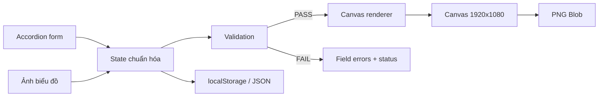

# CNF Strategic Weekly Report Engine — Kế hoạch triển khai

## Giai đoạn 0: Bối cảnh và quyết định

Workspace là dự án mới. Demo HTML ngoài workspace là chuẩn bắt buộc cho output Canvas 1920×1080. UI nhập liệu được chốt là sidebar Accordion; ứng dụng là static web offline, không dependency, backend hoặc API ngoài.

## Giai đoạn 1: Yêu cầu theo EARS

- Khi người dùng thay đổi một trường form, hệ thống phải cập nhật state và lưu nháp localStorage.
- Khi người dùng render với dữ liệu không hợp lệ, hệ thống phải nêu lỗi cạnh trường và không thay đổi preview thành công gần nhất.
- Khi toàn bộ dữ liệu bắt buộc hợp lệ, hệ thống phải render Canvas 1920×1080 theo layout demo.
- Khi người dùng upload ảnh hợp lệ, hệ thống phải hiển thị ảnh trong đúng vùng biểu đồ mà vẫn giữ tỉ lệ.
- Khi người dùng xuất PNG sau một lần render thành công, hệ thống phải tạo file PNG qua `canvas.toBlob()`.
- Khi người dùng nhập JSON lỗi, hệ thống phải giữ state hiện tại và hiển thị lỗi dễ hiểu.
- Khi tổng xác suất kịch bản hoặc tỷ trọng danh mục khác 100%, hệ thống phải chặn render.

## Giai đoạn 2: Đặc tả giải pháp

### Cấu trúc file

| File | Trách nhiệm |
| --- | --- |
| `index.html` | Semantic page shell, form mount point, canvas và live region. |
| `styles.css` | Tokens, responsive layout, Accordion, form states. |
| `js/config.js` | Canvas constants, colors, paths và giới hạn nghiệp vụ. |
| `js/schema.js` | Dữ liệu mẫu và factory state. |
| `js/state.js` | Cập nhật immutable nhẹ, subscription và autosave. |
| `js/validation.js` | Validation và normalizer không phụ thuộc DOM. |
| `js/form.js` | Render/bind form Accordion và dynamic lists. |
| `js/renderer.js` | Các hàm vẽ Canvas theo section của report. |
| `js/storage.js` | localStorage, JSON import/export và đọc ảnh local. |
| `js/export.js` | Export PNG bằng Blob và tên file an toàn. |
| `js/app.js` | Bootstrap, điều phối event và status. |

### Quyết định và đánh đổi

| Quyết định | Lợi ích | Đánh đổi |
| --- | --- | --- |
| JavaScript ES modules thuần | Không dependency, chạy offline, dễ mở file local | Không có component framework. |
| Canvas output cố định | PNG có pixel chính xác như demo | Renderer cần quản lý tọa độ cẩn thận. |
| Form sinh từ state | Không phải nhập JSON, validation rõ | Cần map form-data có kỷ luật. |
| localStorage | Không cần server, dữ liệu ở máy người dùng | Không chia sẻ/đồng bộ đa thiết bị. |

### Edge cases

| Tình huống | Cách xử lý |
| --- | --- |
| Thiếu ảnh biểu đồ | Vẽ placeholder có nhãn upload. |
| Text quá dài | Hàm wrap text giới hạn width/chiều cao vùng vẽ. |
| JSON sai định dạng | Không áp dụng import; hiển thị lỗi parse. |
| localStorage không khả dụng | Vẫn hoạt động trong phiên và cảnh báo không lưu nháp. |
| Ảnh lớn/định dạng không hỗ trợ | Chặn file không phải image; load bất đồng bộ trước render. |
| Export trước render | Disable nút export. |

### Ngoại lệ và trạng thái bất đồng bộ

| Vị trí | Ngoại lệ | Hành vi |
| --- | --- | --- |
| Đọc ảnh | FileReader/Image load fail | Giữ ảnh trước đó, báo lỗi. |
| JSON import | `JSON.parse` fail | Giữ state hiện tại, báo lỗi. |
| PNG export | Blob null hoặc download fail | Báo export thất bại, không reset preview. |
| localStorage | Quota/SecurityError | Bỏ qua autosave và thông báo. |

Không có shared state đa người dùng hay request mạng; race condition chính là nhiều lần upload ảnh. Giải pháp: gắn request id cho mỗi input ảnh và chỉ ghi state nếu kết quả load còn là request mới nhất.

## Giai đoạn 3: Kế hoạch triển khai

### T1.1 — Nền tảng static app

- Mục tiêu: tạo page shell, token CSS, responsive sidebar/preview và entry module.
- Files: `index.html`, `styles.css`, `js/config.js`, `js/app.js`.
- Phụ thuộc: không có.
- Verify: mở `index.html` bằng local static server; sidebar và canvas hiển thị, không có console error.

### T1.2 — Model, state và validation

- Mục tiêu: định nghĩa schema dữ liệu, dữ liệu mẫu, state update và validation thuần.
- Files: `js/schema.js`, `js/state.js`, `js/validation.js`.
- Phụ thuộc: không có.
- Verify: chạy kiểm tra module với dữ liệu hợp lệ, JSON sai, xác suất sai và tỷ trọng sai.

### T2.1 — Form Accordion và upload

- Mục tiêu: render form từ state, dynamic lists, field errors, ảnh upload và status.
- Files: `js/form.js`, sửa `index.html`, `styles.css`, `js/app.js`.
- Phụ thuộc: T1.1, T1.2.
- Verify: nhập dữ liệu, thêm/xóa item, nhận lỗi tại field và upload ảnh thành công.

### T2.2 — Storage và dữ liệu di động

- Mục tiêu: autosave, khôi phục nháp, JSON import/export, đọc ảnh local và xử lý lỗi.
- Files: `js/storage.js`, sửa `js/app.js`.
- Phụ thuộc: T1.2.
- Verify: reload khôi phục state; JSON sai không ghi đè state; export JSON tạo file.

### T2.3 — Canvas renderer

- Mục tiêu: tái tạo đầy đủ layout demo, wrap text, fit ảnh và chart dòng tiền từ data.
- Files: `js/renderer.js`, sửa `js/config.js`, `js/app.js`.
- Phụ thuộc: T1.1, T1.2.
- Verify: dữ liệu mẫu render đủ section trên Canvas 1920×1080, không tràn khung.

### T3.1 — Export PNG và hoàn thiện luồng

- Mục tiêu: export Blob, tên file an toàn, disable/enable action theo trạng thái render.
- Files: `js/export.js`, sửa `js/app.js`, `styles.css`.
- Phụ thuộc: T2.1, T2.2, T2.3.
- Verify: PNG tải thành công, kích thước 1920×1080, export bị disable khi preview chưa hợp lệ.

### T4.1 — Kiểm tra tích hợp và review

- Mục tiêu: kiểm tra thao tác end-to-end, visual sanity và review mã.
- Files: không tạo source mới trừ khi validation artifact cần thiết đã được phê duyệt.
- Phụ thuộc: T3.1.
- Verify: các acceptance checks bên dưới PASS; không console error.

### Dependency & Parallelization Map

| ID task | Tên task | Phụ thuộc vào | Loại | Wave | Phạm vi file |
| --- | --- | --- | --- | --- | --- |
| T1.1 | Nền tảng static app | Không có | Độc lập | 1 | `index.html`, `styles.css`, `js/config.js`, `js/app.js` |
| T1.2 | Model, state và validation | Không có | Độc lập | 1 | `js/schema.js`, `js/state.js`, `js/validation.js` |
| T2.1 | Form Accordion và upload | T1.1, T1.2 | Phụ thuộc | 2 | `js/form.js`, `index.html`, `styles.css`, `js/app.js` |
| T2.2 | Storage và dữ liệu di động | T1.2 | Phụ thuộc | 2 | `js/storage.js`, `js/app.js` |
| T2.3 | Canvas renderer | T1.1, T1.2 | Phụ thuộc | 2 | `js/renderer.js`, `js/config.js`, `js/app.js` |
| T3.1 | Export PNG và hoàn thiện luồng | T2.1, T2.2, T2.3 | Phụ thuộc | 3 | `js/export.js`, `js/app.js`, `styles.css` |
| T4.1 | Kiểm tra tích hợp và review | T3.1 | Phụ thuộc | 4 | toàn bộ scope |

- Wave 1 (song song): T1.1 và T1.2 — không chung file.
- Wave 2: T2.1, T2.2, T2.3 cùng phụ thuộc `js/app.js`; để tránh xung đột, thực hiện tuần tự theo thứ tự T2.1 → T2.2 → T2.3.
- Wave 3: T3.1.
- Wave 4: T4.1.

### Ma trận truy vết

| Yêu cầu | Task |
| --- | --- |
| Form Accordion và tiếng Việt | T1.1, T2.1 |
| Validation và state | T1.2, T2.1 |
| Upload ảnh / dữ liệu động | T2.1, T2.2 |
| Canvas đúng demo | T2.3 |
| Autosave và JSON | T2.2 |
| PNG Blob 1920×1080 | T3.1 |
| Kiểm tra end-to-end | T4.1 |

## Acceptance checks cuối pipeline

1. Mở app qua local static server không có console error.
2. Dữ liệu mẫu render thành công và Canvas có kích thước 1920×1080.
3. Lỗi dữ liệu chặn render và được hiển thị đúng field.
4. Upload cả hai biểu đồ hiển thị đúng vùng Canvas.
5. Reload khôi phục dữ liệu draft nếu localStorage khả dụng.
6. Import JSON sai không làm mất dữ liệu đang nhập.
7. PNG export thành công với kích thước gốc.

## Kế hoạch kiểm thử

Không tạo test framework hoặc dependency mới vì ứng dụng static nhỏ và yêu cầu không thêm dependency. Thực hiện validation module bằng script kiểm tra nhẹ nếu có thể chạy bằng Node, cùng với kiểm tra browser thủ công theo acceptance checks.

## Rollback

Mọi file mới nằm trong scope app; rollback là xóa các file được tạo sau khi có xác nhận của user. Không thay đổi file demo gốc hoặc cấu hình hệ thống.
